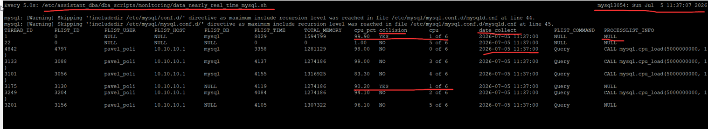
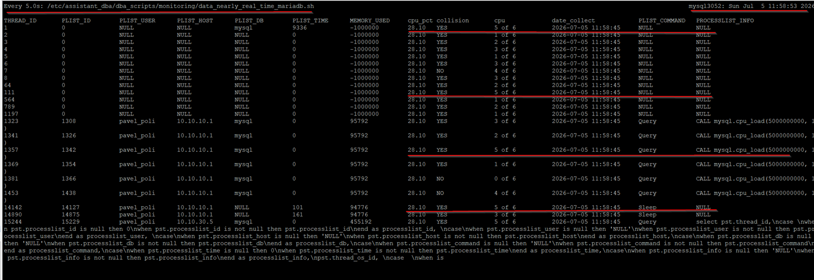

Written by Pavel A. Polikov https://github.com/PahanDba/mysql_dba


Monitoring CPU and RAM pressure caused by queries on the MySQL/MariaDB server.


# **Table of contents**
[**System requirements**](#_toc238665030)

[**List of servers for demonstrating the configuration of the 'add-on' for monitoring CPU and RAM pressure caused by queries on the MySQL/MariaDB server.**](#_toc238665031)

[***Server mysql3054***](#_toc238665032)

[***Server mysql3052***](#_toc238665033)

[**Configuring the 'add-on' for monitoring CPU and RAM pressure caused by queries on the MySQL/MariaDB server.**](#_toc238665034)

[***Registering the procedures on the MySQL/MariaDB server.***](#_toc238665035)

[***Configuring the tool called 'top' to export data in the required format.***](#_toc2386650351")

[***Preparing the directory structure***](#_toc238665036)

[**The description of the components of the 'add-on' for monitoring CPU and RAM pressure caused by queries on the MySQL/MariaDB server.**](#_toc238665037)

[**The description of the table for storing historical data is assistant_dba.monitoring_of_pressure_history.**](#_toc238665038)

[**Using the 'add-on' for monitoring CPU and RAM pressure caused by queries on the MySQL/MariaDB server.**](#_toc238665039)

[***Description***](#_toc238665040)

[***An example of the script output***](#_toc238665041)

[**Removing the services and the structures of the directories.**](#_toc238665042)

[**Summary**](#_toc238665043)


**Script goal: "Monitoring CPU and RAM pressure caused by queries on the MySQL/MariaDB server"**

- It helps MySQL DBAs analyze CPU and RAM pressure caused by queries on the MySQL server.

Attention! Before performing any of the operations described in this article, you must read the article to the end, so that you understand how this add-on works and how to stop it.


# <a name="_toc238665030"></a>**System requirements**

- You need to correctly configure the configuration file of the tool called "top" on the MySQL/MariaDB server. The setup of the configuration file of the tool called "top" is described below.
- The tool called "top" needs to be version 4.
- The parameter called "thread-handling" on the MySQL server needs to be set to "one-thread-per-connection".
- The parameter called "performance_schema" on the MySQL server needs to be enabled. The necessary settings for MySQL/MariaDB are:

      performance_schema=ON
      performance-schema-consumer-events-statements-history=ON
      performance-schema-consumer-events-statements-current=ON
      performance-schema-consumer-events-statements-history-long=ON
      performance-schema-consumer-events-transactions-current=ON
      performance-schema-consumer-events-transactions-history=ON
      performance-schema-events-statements-history-size=100
      performance-schema-instrument='statement/%=ON'

- The parameter called "secure-file-priv" on the MySQL server needs to be set to '' (empty value), or you can set the value to '/tmp'. The intermediate files for uploading into the database will be downloaded into this directory.
- Debian 12
- MySQL 8.0.X / Percona Server for MySQL 8.0.X / MariaDB 11.X


# <a name="_toc238665031"></a>**List of servers for demonstrating the configuration of the 'add-on' for monitoring CPU and RAM pressure caused by queries on the MySQL/MariaDB server.**

Below is a list of servers with descriptions of each server and the software installed on it, used to check the functionality of this 'add-on'. This 'add-on' works on both the master server and the replica server.

## <a name="_toc238665032"></a>***Server mysql3054***
      ServerName: mysql3054
      IP address: 10.10.30.54
      OS: Debian 12
      RDBMS: Percona for MySQL 8.0.43-34
      Server configuration: 6 CPU, 6 GB RAM, 30GB

## <a name="_toc238665033"></a>***Server mysql3052***
      ServerName: mysql3052
      IP address: 10.10.30.52
      OS: Debian 12
      RDBMS: MariaDB 10.11
      Server configuration: 6 CPU, 6 GB RAM, 30GB


# <a name="_toc238665034"></a>**Configuring the 'add-on' for monitoring CPU and RAM pressure caused by queries on the MySQL/MariaDB server**.

## <a name="_toc238665035"></a>***Registering the procedures on the MySQL/MariaDB server.***

To register the procedures, you need to choose the appropriate script: for the MySQL - monitoring_of_pressure_mysql.sql; for the MariaDB — monitoring_of_pressure_mariadb.sql.

You need to connect to the MySQL server and execute the code from the file monitoring_of_pressure_mysql.sql. It will create the following procedures in the database assistant_dba: 

- monitoring_of_pressure_check_pct_per_core_mysql
- monitoring_of_pressure_check_prepare_tables_mysql_top *(the shared procedure for MySQL and MariaDB)*
- monitoring_of_pressure_insert_mysql
- monitoring_of_pressure_maintenance
- monitoring_of_pressure_nearly_real_time_mysql

You need to connect to the MariaDB server and execute the code from the file monitoring_of_pressure_mysql.sql. It will create the following procedures in the database assistant_dba:

- monitoring_of_pressure_check_pct_per_core_mariadb
- monitoring_of_pressure_check_prepare_tables_mysql_top *(the shared procedure for MySQL and MariaDB.)*
- monitoring_of_pressure_insert_mariadb
- monitoring_of_pressure_maintenance
- monitoring_of_pressure_nearly_real_time_mariadb


 <a name="_toc2386650351"></a>***Configuring the tool called 'top' to export data in the required format.***

1. You need to connect to the database server via SSH.
1. Run the command 'top' with the parameter: top -H
1. Press the 'f' key.
1. Choose the row with character P = Last Used CPU (SMP) and press the SPACE key.
1. Press the ESC or 'q' key.
1. Press SHIFT + W to write the settings to the configuration file. The configuration file will be saved in the directory /home/username/.config/procps/toprc, where username is the user for whom the session ran the 'top' tool.
1. You need to verify that IRIX mode is enabled for the displayed CPU values. Find the word 'irixps' and check that its value equals 1. If the value equals 0, you need to correct it so that the value equals 1.


## <a name="_toc238665036"></a>***Preparing the directory structure***

1\. You need to save the file step1_structure.sh in the directory /tmp. You need to make it executable with the following commands:
```sh
sudo sed -i -e 's/\r$//' /tmp/step1_structure.sh
sudo chown root  /tmp/step1_structure.sh
sudo chmod 755  /tmp/step1_structure.sh
```

You need to execute it in the session of a user who has the privileges to execute the command called ‘sudo’.
```sh
/tmp/step1_structure.sh
```

If you prepared the configuration file for the ‘top’ tool, then the script continues working and it will create the directory structure and prepare the files:

/etc/assistant_dba – the common directory to store the configuration files and scripts
/etc/assistant_dba/conf – the directory to the store the configuration files
/etc/assistant_dba/conf/.config - the directory to store the configuration file for the ‘top’ tool 
/etc/assistant_dba/conf/.config/procps - the configuration file the ‘top’ tool 
/etc/assistant_dba/dba_scripts – the directory to store the scripts

/etc/assistant_dba/conf/monitoring.conf – the configuration file for the connection to the MySQL/MariaDB server

The file /etc/assistant_dba/conf/monitoring.conf has the following structure:
```
[client]
host=ip_your_mysql_server
port=port_your_mysql_server
user=your_user_mysql
password=your_password_mysql
```


You need to change these parameters before executing the script /tmp/step2_structure_mysql.sh or /tmp/step2_structure_mariadb.sh.\
This script will change the parameter mode_irixps from 0 to 1.


2\. For the **MySQL** server, you need to save the following files:

      data_check_prepare_insert_mysql.service
      data_check_prepare_insert_mysql.sh
      data_check_prepare_insert_mysql.timer
      data_maintenance.service
      data_maintenance.sh
      data_maintenance.timer
      data_mysql.service
      data_mysql.sh
      data_mysql.timer
      data_nearly_real_time_mysql.sh
      data_top_mysql.service
      data_top_mysql.sh
      data_top_mysql.timer
      step2_structure_mysql.sh

in the directory /tmp.


For the **MariaDB** server, you need to save the following files:

      data_check_prepare_insert_mariadb.service
      data_check_prepare_insert_mariadb.sh
      data_check_prepare_insert_mariadb.timer
      data_maintenance.service
      data_maintenance.sh
      data_maintenance.timer
      data_mariadb.service
      data_mariadb.sh
      data_mariadb.timer
      data_nearly_real_time_mariadb.sh
      data_top_mariadb.service
      data_top_mariadb.sh
      data_top_mariadb.timer
      step2_structure_mariadb.sh

in the directory /tmp

You need to save the file step2_structure_mariadb.sh or step2_structure_mysql.sh, depending on whether you use MySQL/MariaDB in your work, in the directory /tmp. You need to make it executable with the following command: 

```sh
sudo sed -i -e 's/\r$//' /tmp/step2_structure_mysql.sh
sudo chown root  /tmp/step2_structure_mysql.sh
sudo chmod 755  /tmp/step2_structure_mysql.sh
```

or

```sh
sudo sed -i -e 's/\r$//' /tmp/step2_structure_mariadb.sh
sudo chown root  /tmp/step2_structure_mariadb.sh
sudo chmod 755  /tmp/step2_structure_mariadb.sh
```

You need to execute the file in the session of the user who has the privilege to execute the ‘sudo’ command:

```sh
/tmp/step2_structure_mysql.sh
```

or

```sh
/tmp/step2_structure_mariadb.sh
```


The script will copy the files into the special directories:

For the **MySQL** server

      /tmp/data_mysql.service to /etc/systemd/system/data_mysql.service
      /tmp/data_mysql.sh to /etc/assistant_dba/dba_scripts/monitoring/data_mysql.sh
      /tmp/data_mysql.timer to /etc/systemd/system/data_mysql.timer
      /tmp/data_top_mysql.service to /etc/systemd/system/data_top_mysql.service
      /tmp/data_top_mysql.sh to /etc/assistant_dba/dba_scripts/monitoring/data_top_mysql.sh
      /tmp/data_top_mysql.timer to /etc/systemd/system/data_top_mysql.timer
      /tmp/data_maintenance.service to /etc/systemd/system/data_maintenance.service
      /tmp/data_maintenance.sh to /etc/assistant_dba/dba_scripts/monitoring/data_maintenance.sh
      /tmp/data_maintenance.timer to /etc/systemd/system/data_maintenance.timer
      /tmp/data_check_prepare_insert_mysql.service to /etc/systemd/system/data_check_prepare_insert_mysql.service
      /tmp/data_check_prepare_insert_mysql.sh to /etc/assistant_dba/dba_scripts/monitoring/data_check_prepare_insert_mysql.sh
      /tmp/data_check_prepare_insert_mysql.timer to /etc/systemd/system/data_check_prepare_insert_mysql.timer
      /tmp/data_nearly_real_time_mysql.sh to /etc/assistant_dba/dba_scripts/monitoring/data_nearly_real_time_mysql.sh

For the **MariaDB** server

      /tmp/data_mysql.service to /etc/systemd/system/data_mysql.service
      /tmp/data_mysql.sh to /etc/assistant_dba/dba_scripts/monitoring/data_mysql.sh
      /tmp/data_mysql.timer to /etc/systemd/system/data_mysql.timer
      /tmp/data_top_mysql.service to /etc/systemd/system/data_top_mysql.service
      /tmp/data_top_mysql.sh to /etc/assistant_dba/dba_scripts/monitoring/data_top_mysql.sh
      /tmp/data_top_mysql.timer to /etc/systemd/system/data_top_mysql.timer
      /tmp/data_maintenance.service to /etc/systemd/system/data_maintenance.service
      /tmp/data_maintenance.sh to /etc/assistant_dba/dba_scripts/monitoring/data_maintenance.sh
      /tmp/data_maintenance.timer to /etc/systemd/system/data_maintenance.timer
      /tmp/data_check_prepare_insert_mysql.service to /etc/systemd/system/data_check_prepare_insert_mysql.service
      /tmp/data_check_prepare_insert_mysql.sh to /etc/assistant_dba/dba_scripts/monitoring/data_check_prepare_insert_mysql.sh
      /tmp/data_check_prepare_insert_mysql.timer to /etc/systemd/system/data_check_prepare_insert_mysql.timer
      /tmp/data_nearly_real_time_mysql.sh to /etc/assistant_dba/dba_scripts/monitoring/data_nearly_real_time_mysql.sh

It will prepare the files for use, remove the unnecessary characters from the files, and set the appropriate attributes to execute these files. 

It will register services to execute bash scripts for data collecting.


# <a name="_toc238665037"></a>**The description of the components of the 'add-on' for monitoring CPU and RAM pressure caused by queries on the MySQL server.**


**The purpose of the files and procedures on the MySQL server**

- **data_check_prepare_insert_mysql.service** – the service for executing the script data_check_prepare_insert_mysql.sh; by default, it executes the script every 5 seconds.
- **data_check_prepare_insert_mysql.sh** – the script for executing the procedures that add and insert data into the table storing workload data, including which threads did what and how many resources they used.
- **data_check_prepare_insert_mysql.timer** – the timer for the service data_check_prepare_insert_mysql.service.
- **data_maintenance.service** – the service for executing the script data_maintenance.sh; by default, it executes the script every 5 seconds.
- **data_maintenance.sh** – the script for cleaning old data from the table storing workload history, as well as tables with intermediate data.
- **data_maintenance.timer** – the timer for the service data_maintenance.service.
- **data_mysql.service** – the service for executing the script data_mysql.sh; by default, it executes the script every 5 seconds.
- **data_mysql.sh** – the script for retrieving data from MySQL.
- **data_mysql.timer** – the timer for the service data_mysql.service.
- **data_nearly_real_time_mysql.sh** – the script for executing the procedure monitoring_of_pressure_nearly_real_time_mysql.
- **data_top_mysql.service** – the service for executing the script data_top_mysql.sh; by default, it executes the script every 5 seconds.
- **data_top_mysql.sh** – the script for retrieving data from the 'top' tool.
- **data_top_mysql.timer** – the timer for the service data_top_mysql.service.
- **assistant_dba.monitoring_of_pressure_check_pct_per_core_mysql** – this procedure sets the value 'YES' in the column 'collision' when the total workload per CPU core exceeds 100%.
- **assistant_dba.monitoring_of_pressure_check_prepare_tables_mysql_top** – this procedure prepares intermediate tables containing information from performance_schema.threads and the 'top' tool.
- **assistant_dba.monitoring_of_pressure_insert_mysql** – this procedure inserts data from the intermediate tables (from performance_schema.threads and the 'top' tool) into a single unified format, including thread_id, CPU core workload, RAM workload, the query text (if available), etc.
- **assistant_dba.monitoring_of_pressure_maintenance** – this procedure cleans old data from the table storing workload history and deletes the tables with intermediate data. By default, this procedure deletes data older than 14 days.
- **assistant_dba.monitoring_of_pressure_nearly_real_time_mysql** – this procedure returns the list of connections putting pressure on the CPU, based on the most recent state recorded in the table assistant_dba.monitoring_of_pressure_history.


**The purpose of the files and procedures on the MariaDB server**

- **data_check_prepare_insert_mariadb.service** – the service for executing the script data_check_prepare_insert_mariadb.sh ; by default, it executes the script every 5 seconds.
- **data_check_prepare_insert_mariadb.sh** – the script for executing the procedures that add and insert data into the table storing workload data, including which threads did what and how many resources they used.
- **data_check_prepare_insert_mariadb.timer** – the timer for the service data_check_prepare_insert_mysql.service.
- **data_maintenance.service** – the service for executing the script data_maintenance.sh; by default, it executes the script every 5 seconds.
- **data_maintenance.sh** – the script for cleaning old data from the table storing workload history, as well as tables with intermediate data.
- **data_maintenance.timer** – the timer for the service data_maintenance.service
- **data_maraidb.service** – the service for executing the script data_mariadb.sh; by default, it executes the script every 5 seconds.
- **data_mariadb.sh** – the script for retrieving data from  MariaDB
- **data_mariadb.timer** – the timer for the service data_mariadb.service
- **data_nearly_real_time_mariadb.sh –** the script for executing the procedure monitoring_of_pressure_nearly_real_time_mariadb.
- **data_top_mariadb.service** – the service for executing the script data_top_mysql.sh; by default, it executes the script every 5 seconds.
- **data_top_mariadb.sh** – the script for retrieving data from the 'top' tool.
- **data_top_mariadb.timer** – the timer for the service data_top_mariadb.service.
- **assistant_dba.monitoring_of_pressure_check_pct_per_core_mariadb** – this procedure sets the value 'YES' in the column 'collision' when the total workload per CPU core exceeds 100%.
- **assistant_dba.monitoring_of_pressure_check_prepare_tables_mysql_top** – this procedure prepares intermediate tables containing information from performance_schema.threads and the 'top' tool.
- **assistant_dba.monitoring_of_pressure_insert_mariadb** – this procedure inserts data from the intermediate tables (from performance_schema.threads and the 'top' tool) into a single unified format, including thread_id, CPU core workload, RAM workload, the query text (if available), etc.
- **assistant_dba.monitoring_of_pressure_maintenance** – this procedure cleans old data from the table storing workload history and deletes the tables with intermediate data. By default, this procedure deletes data older than 14 days.
- **assistant_dba.monitoring_of_pressure_nearly_real_time_mariadb** – this procedure returns the list of connections putting pressure on the CPU, based on the most recent state recorded in the table assistant_dba.monitoring_of_pressure_history.


**Attention!!!**

The services **data_mysql.service / data_mariadb.service** and **data_top_mysql.service** / **data_top_mariadb.service** need to have the same start interval because the time of execution serves as one of the key factors for matching the results of downloading data from MySQL/MariaDB and the ‘top’ tool.

The service **data_check_prepare_insert_mysql.service** / **data_check_prepare_insert_mariadb.service** needs to have the start interval, which depends on the start intervals of the services **data_mysql.service / data_mariadb.service** and **data_top_mysql.service** / **data_top_mariadb.service** for the potential timely processing of the intermediate files.

You can change the launch interval of the services depending on your workload. You can modify the service interval in files with the extension called  'timer'. You shouldn’t use the launch interval less than 2 seconds. In my script, the 'top' tool  uses an interval of 1 second and 2 snapshots; that is, the total runtime of the tool will be nearly 2 seconds.


# <a name="_toc238665038"></a>**The description of the table for storing historical data is assistant_dba.monitoring_of_pressure_history.** 

The full description of most fields you can see on the page <https://dev.mysql.com/doc/mysql-perfschema-excerpt/8.0/en/performance-schema-threads-table.html> for MySQL, and <https://mariadb.com/docs/server/reference/system-tables/information-schema/information-schema-tables/information-schema-processlist-table> and <https://mariadb.com/docs/server/reference/system-tables/performance-schema/performance-schema-tables/performance-schema-threads-table> for MariaDB. I'll demonstrate the short description of fields.

- **id** - the unique identifier of rows in the table
- **THREAD_ID** - a unique thread identifier. See the link above. 
- **PROCESSLIST_ID** - for a foreground thread (associated with a user connection), this is the connection identifier. See the link above. 
- **PROCESSLIST_USER** - the user associated with a foreground thread, NULL for a background thread. See the link above.
- **PROCESSLIST_HOST** - the host name of the client associated with a foreground thread, NULL for a background thread. See the link above.
- **PROCESSLIST_DB** - the default database for the thread, or NULL if none has been selected. See the link above.
- **PROCESSLIST_COMMAND** - for foreground threads, the type of command the thread is executing on behalf of the client, or Sleep if the session is idle. See the link above.
- **PROCESSLIST_TIME** - the time in seconds that the thread has been in its current state. See the link above.
- **PROCESSLIST_INFO** - the statement the thread is executing, or NULL if it is executing no statement. See the link above. 
- **THREAD_OS_ID** - the thread or task identifier as defined by the underlying operating system... See the link above.

- **TOTAL_MEMORY** - the current amount of memory, controlled or not, used by the thread (MySQL). See the link above.
- /
- **MEMORY_USED** - memory in bytes used by the thread (MariaDB). See the link above.

- **MAX_TOTAL_MEMORY** - the maximum value of TOTAL_MEMORY seen during the thread execution. See the link above.
- /
- **MAX_MEMORY_USED** - maximum memory in bytes used by the thread. See the link above.

- **tid** - the thread_id from the OS of the 'top' tool.
- **cpu_pct** - the current load on the CPU core in the percentage of the 'top' tool.
- **collision** - this column has ''Yes'' when the total of the values of the column cpu_pct is greater than 100 per cent.
- **command_top** - the command as it's demonstrated on the 'top' tool.
- **cpuid** - the ID of the core.
- **cpu_count** – the number of cores on the OS.
- **date_collect** - the date and time when the event was collected


# <a name="_toc238665039"></a>**Using the 'add-on' for monitoring CPU and RAM pressure caused by queries on the MySQL/MariaDB server.**

## <a name="_toc238665040"></a>***Description***
This 'add-on' helps you see which processes are running on MySQL, and when, and how many CPU and RAM resources of the MySQL/MariaDB server are being used.

A demonstration of the operation and a description of the logic of the add-on "Monitoring CPU and RAM pressure caused by queries on the MySQL/MariaDB server."

**The configuration of the database server:**

- CPU: 6 cores
- RAM: 6 GB
- MySQL: Percona for MySQL 8.0.43-34, with the parameter thread-handling = 'one-thread-per-connection'

The services running as part of this 'add-on' use the default settings.

To create a CPU workload, I'll create 6 connections to the MySQL/MariaDB server (matching the number of cores on the server); each connection will run a procedure that performs complex mathematical operations. The procedure will execute these operations approximately 5,000,000,000 times.

To get data similar to real-time data, you need to connect to the server via SSH and execute the following script:

```shell
watch -n 5 /etc/assistant_dba/dba_scripts/monitoring/data_nearly_real_time_mysql.sh
```

or

```shell
watch -n 5 /etc/assistant_dba/dba_scripts/monitoring/data_nearly_real_time_mariadb.sh
```

This command executes the bash script every 5 seconds. The script runs the procedure assistant_dba.monitoring_of_pressure_nearly_real_time, which returns a list of connections putting pressure on the CPU, based on the most recent data inserted into the table assistant_dba.monitoring_of_pressure_history.


## <a name="_toc238665041"></a>***An example of the script output***

I'll demonstrate how the output of the column showing the executed query can change.

The first screenshot demonstrates a situation of core overload: the total workload exceeds 100% per core. I assume that the processes are competing for one core, and each process doesn't actually use the CPU at 100%, because the total load couldn't have exceeded this threshold otherwise.

This means that the server has a high CPU workload. To reduce the workload, I recommend one of the following actions:

- Correct the query;
- Optimize the structure of the objects used in the query;
- Add more CPU cores to the system;
- Distribute the queries across different execution times.

Additionally, you need to take into account the scheduler's behavior:

- The column P (Last used CPU) shows the last core on which the thread was running, but this does not mean that the thread ran only on this core;
- The Linux scheduler can migrate threads between cores between snapshots taken by the 'top' tool, so the value of P reflects only an instantaneous state.

**Screen 1 MySQL**



This screenshot demonstrates that the CPU has a load of 90.2%; the 'Query' column shows the value NULL. This is expected: at the time of the snapshot, the previous query had already finished, but a new query had not started yet, so no new query was recorded. The snapshot reflects this intermediate state of the MySQL server's processes.

**Screen 2 MariaDB**



For MariaDB, I replaced the value 'NULL' in the column 'memory_used' with the value '-1000000'.

# <a name="_toc238665042"></a>**Removing the services and the structures of the directories.**

To stop and remove the services, you can use the following files:

For MySQL structure_remove_mysql.sh

For MariaDB structure_remove_mariadb.sh

Put this file into the directory /tmp and execute the following commands:

For **MySQL**

```sh
sudo sed -i -e 's/\r$//' /tmp/structure_remove_mysql.sh
sudo chown root  /tmp/structure_remove_mysql.sh
sudo chmod 755  /tmp/structure_remove_mysql.sh
/tmp/structure_remove_mysql.sh
```

For **MariaDB**


```sh
sudo sed -i -e 's/\r$//' /tmp/structure_remove_mariadb.sh
sudo chown root  /tmp/structure_remove_mariadb.sh
sudo chmod 755  /tmp/structure_remove_mariadb.sh
/tmp/structure_remove_mariadb.sh
```

# <a name="_toc238665043"></a>**Summary**

This ‘add-on’ shows, nearly in real time, the list of connections to the MySQL/MariaDB server that put a workload on the CPU and RAM.

You can download this script and other scripts from <https://github.com/PahanDba/mysql_dba/>.


